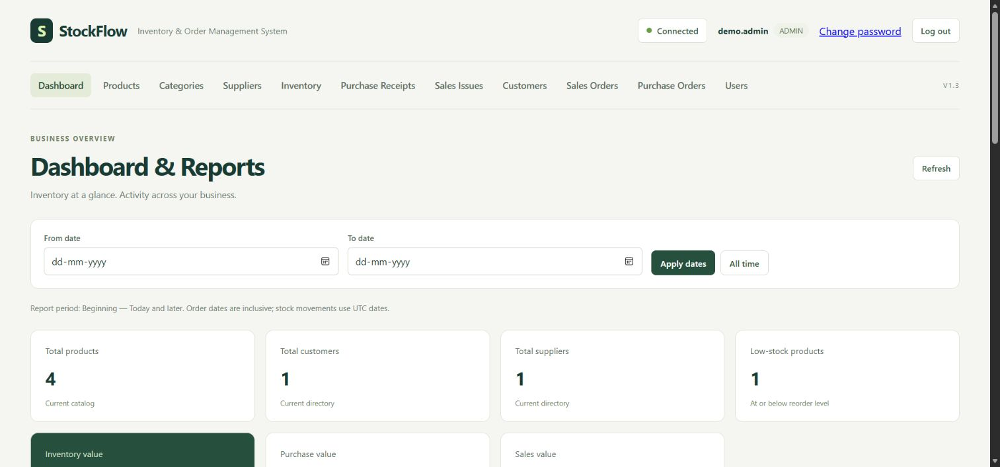
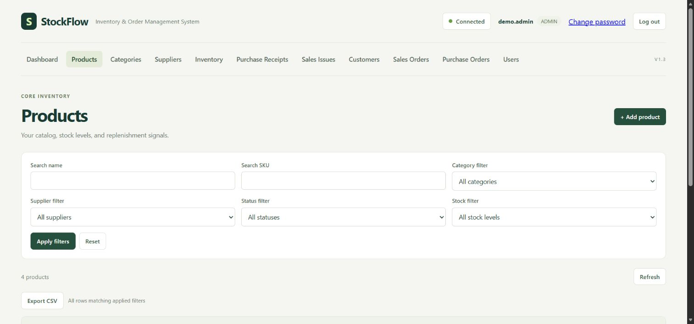
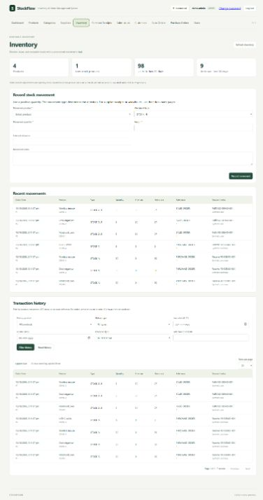
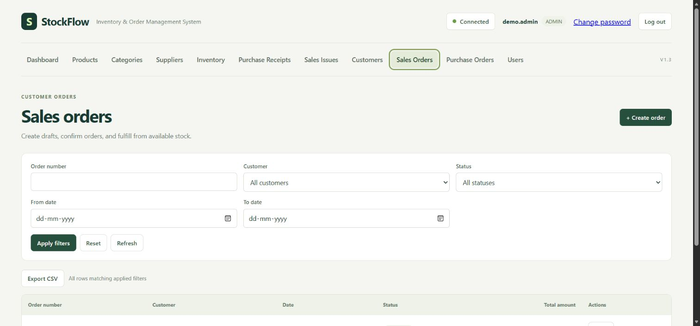
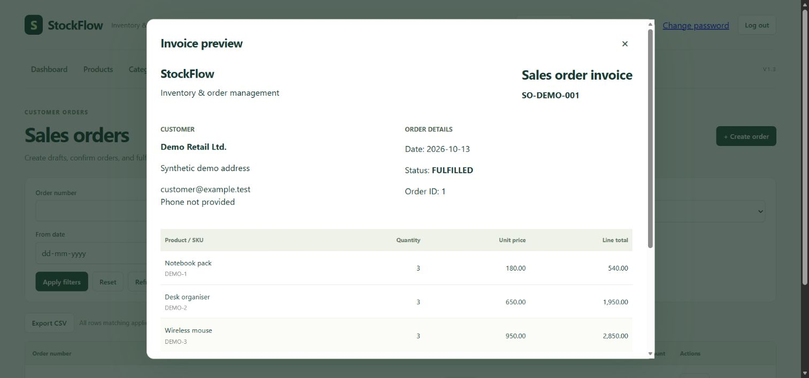
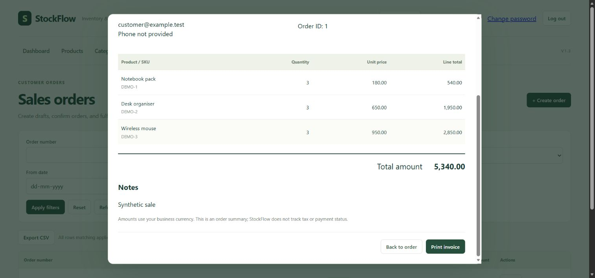

# StockFlow screenshots

Captured from the actual application using its isolated H2 test launcher and synthetic records on 13 October 2026. The fixtures were created through the normal APIs: purchase receipt adds stock and sales fulfillment deducts it. These images do not imply a hosted commercial deployment.

## Dashboard

## Products after purchase receipt and sale

## Inventory history

## Fulfilled sales order

## Invoice preview

The second view shows the scrollable preview's calculated total of 5,340.00.

## Login

